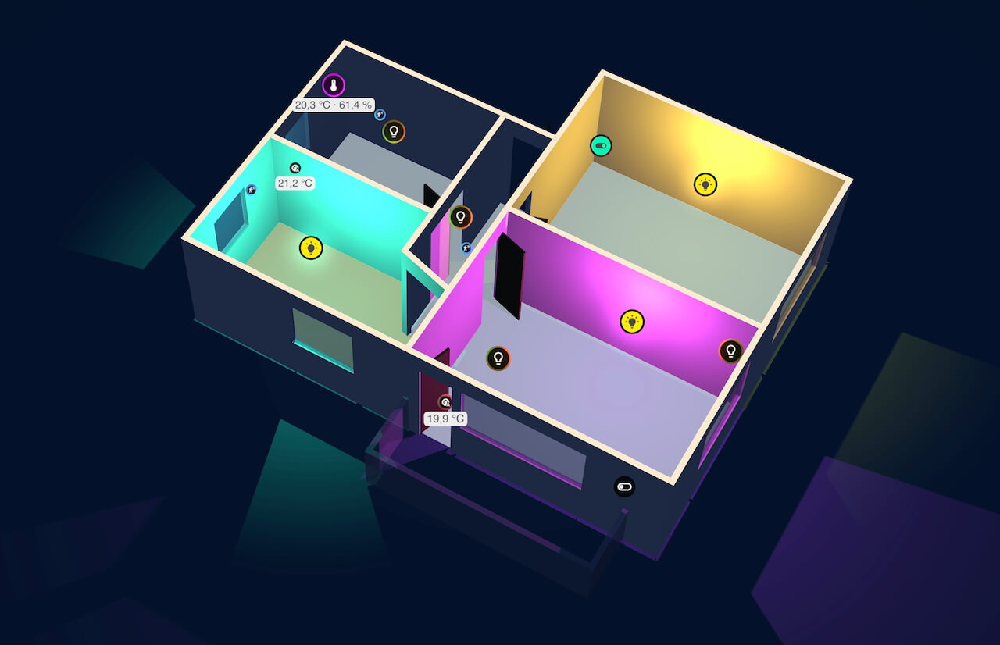
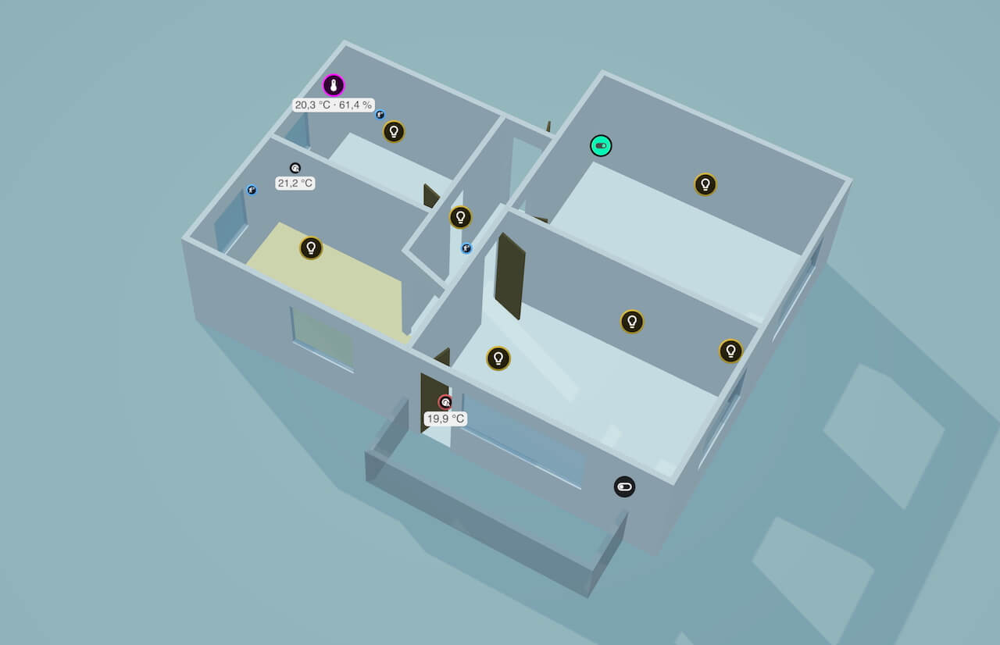
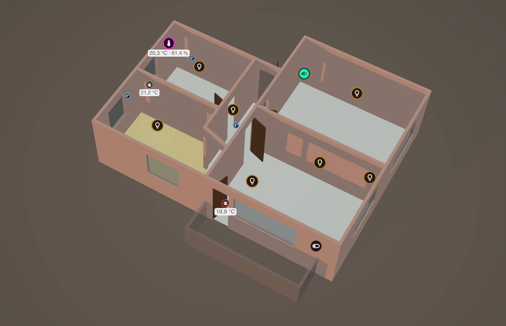

# Easy Floorplan - 3D View

A Home Assistant custom card that reads your [Easy Floorplan](https://github.com/nicosandller/easy-floorplan) and renders it in 3D.  





https://github.com/user-attachments/assets/6442806f-e3ca-46ba-901a-33db277c2f3f

## Disclaimer

- Proof of concept — **expect loose ends**, and plenty of them
- Only a **tiny subset** of Easy Floorplan's card configuration is supported
- This is only a **view**. Your floorplan is still configured in Easy Floorplan

## Compatibility

Other versions may work, but are untested. Please report other working versions.
- Home Assistant 2026.10.1
- Easy Floorplan 2.x, 3.x

## General

- **3D View**: Shows your existing Easy Floorplan layout as a 3D model
- **Link your existing floorplan**: Select the dashboard → view → Easy Floorplan → floor
- **Start with active area**: Optionally select an area to start with the view zoomed in
- **Interactive camera**: Rotate, pan, and zoom around

## View

- **Live device markers**: Lights, switches, and climate devices show their current state
- **Visibility toggles**: Show or hide furniture, devices, light glow, entity names, or entity IDs
- **Cut-away**: Slice the walls at any height to see inside, with an optional contrast mode
- **Marker size limits**: Keep icons readable at any zoom level

## Sun & Daylight

- **Daylight simulation**: The lighting follows the real sun position at your location. Override time of day and month to preview other conditions
- **Adjustable North**: Adjust the north direction to align your floorplan with the real world

## Installation
### HACS
-	Install [HACS](https://hacs.xyz/docs/use/download/download/), then click
    - [](https://my.home-assistant.io/redirect/hacs_repository/?owner=rolbr&category=frontend&repository=https%3A%2F%2Fgithub.com%2Frolbr%2Feasy-floorplan-3d-view)

- or add manually:
  -	In HACS, open the menu `⋮`, choose `Custom repositories`, add the repo URL `https://github.com/rolbr/easy-floorplan-3d-view`, and pick the `Dashboard` category
  -	Download `Easy Floorplan - 3D View` and hard-reload your browser (`Ctrl/Cmd + Shift + R`)


### Manual
- Download `easy-floorplan-3d-view.js` from the latest release
- Copy it to `<config>/www/easy-floorplan-3d-view.js`
- Add a dashboard resource under `Settings` → `Dashboards` → `⋮` → `Resources` → `Add`
- URL `/local/easy-floorplan-3d-view.js`, Type `JavaScript module`
- Hard-reload your browser


### Sample Config
```yaml
type: custom:easy-floorplan-3d-view
source:
  card_type: custom:easy-floorplan-card
  dashboard: dashboard-abc
  view: main
  card_index: 1 # only required if view contains more than one easy-floorplan-card
  floor_id: floor_main
  area_id: area_3f90q27 # optional: start focused on this area
north_offset: 30 # optional
north_marker: # optional
  visible: false
  distance: 1
  width: 0.3
  length: 4
```

## Room for improvement
- fix existing features to use Easy Floorplan config values instead of own values
- extend supported Easy Floorplan feature set
- refine / add furniture models
- use LitElement for rendering UI
- save visibility filters to config
- sync visibility filters between card instances
- add tests
- …

## License

MIT, see [LICENSE.md](LICENSE.md).
